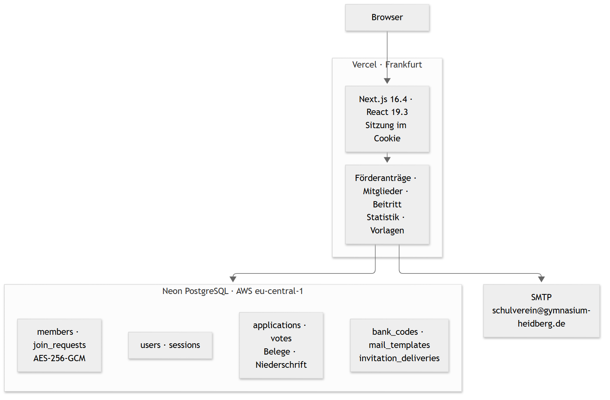

# Schulverein – Förderanträge



Web-App für die Abstimmung über Förderanträge des Schulvereins des Gymnasiums Heidberg e.V.

Produktion: [schulverein.vercel.app](https://schulverein.vercel.app)

Die Seite ist nicht für Suchmaschinen bestimmt. Ohne persönliche Anmeldung erscheint nur der Hinweis, den zugesendeten Zugangslink zu nutzen.

## Funktionen

- Förderanträge mit Datum, Antragsteller, Zweck und Höchstbetrag anlegen, ändern und entfernen, solange die Abstimmung offen ist.
- Mit Ja oder Nein abstimmen. Genehmigt ist ein Antrag, wenn mehr als die Hälfte der Stimmberechtigten mit Ja stimmt.
- Belege an offenen Anträgen hinterlegen (JPEG, PNG, WebP, GIF, HEIC, HEIF, PDF; höchstens 12 Dateien, je 4 MB) und in der Vorschau mit Lupe ansehen.
- Die Abstimmung abschließen, sobald ein Beleg hinterlegt ist. Das kann nur der Schatzmeister. Danach sind Antrag, Stimmen und Belege festgeschrieben. Der Höchstbetrag darf über dem Betrag auf dem Beleg liegen.
- Alle Anträge als CSV und als PDF exportieren. Kontodaten werden nicht gespeichert.
- Benutzer mit Schreib- oder Leserecht anlegen, den persönlichen Zugangslink erneuern und Konten ohne abgegebene Stimme entfernen.

Auf dem Notebook (ab 1200 px Breite) stehen die Anträge in einer Tabelle. Darunter erscheinen sie als Karten.

## Rechte

Personen mit Schreibrecht legen Anträge an, stimmen ab, pflegen Belege und Benutzer. Personen mit Leserecht sehen die Anträge und können CSV und PDF herunterladen. Abschließen bleibt dem Schatzmeister vorbehalten.

Neue Konten entstehen in der Benutzerverwaltung. Der Schatzmeister wird dort nicht neu vergeben.

## Anmeldung

Jede Person hat einen dauerhaften persönlichen Link. Der Link wird nur als SHA-256-Hash gespeichert. Ein Aufruf legt eine Sitzung von 30 Tagen im Cookie `sv_session` an; auch die Sitzung liegt nur gehasht in der Datenbank. Der Link selbst bleibt gültig und wird nicht in Referrer-Headern weitergegeben.

## Sicherheit

Mitgliedsdaten, Konten und Beitritte sind vertraulich. Die Anwendung hält sie mit den heute üblichen Mitteln geschlossen.

- **Ort.** Die Anwendung läuft bei Vercel in Frankfurt. Die Datenbank liegt bei Neon in der AWS-Region eu-central-1, ebenfalls Frankfurt.
- **Verbindung.** Die Verbindung zur Datenbank ist verschlüsselt. Das Zertifikat des Datenbankservers wird geprüft.
- **Speicherung.** Name, E-Mail, IBAN, BIC und das Lastschriftmandat eines Mitglieds liegen mit AES-256-GCM in der Datenbank. Jeder Datensatz erhält einen eigenen Zufallswert, der Schlüssel ist 256 Bit lang. Zugangslinks, Sitzungen und Bestätigungslinks speichert die Datenbank nur als SHA-256-Hash. Das Protokoll nennt keine IBAN und keine E-Mail-Adresse.
- **Schlüssel.** Datenbankkennwort und Verschlüsselungsschlüssel liegen in den Umgebungsvariablen von Vercel und Neon. Das Repository enthält den Quelltext und keine Zugangsdaten.
- **Zugriff.** Ohne den persönlichen Link sind keine Daten zu sehen. Die Sitzung steht in einem `httpOnly`-Cookie, gilt 30 Tage und wird in Produktion nur über HTTPS gesendet. Lesen und Ändern der Mitglieder richtet sich nach dem gespeicherten Recht. Nach der ersten Erfassung zeigt der Änderungsdialog die Kontodaten nicht mehr. Zwei Personen, die gleichzeitig beitreten, sehen nur die eigenen Angaben.
- **Browser.** Produktion erzwingt HTTPS. Die Seiten lassen sich nicht in fremde Rahmen setzen, der Referrer bleibt leer, und Skripte kommen nur von der eigenen Adresse und vom Bootstrap-CDN. Suchmaschinen sind ausgeschlossen. Anmeldung und Beitritt werden nicht zwischengespeichert.
- **Revision.** Abgeschlossene Abstimmungen schreiben Trigger in PostgreSQL fest. Diese Trigger legt ein eigenes Datenbankkonto an. Das Konto der laufenden Anwendung kann sie nicht ändern.
- **Beitritt.** Das Formular verlangt eine gültige E-Mail-Adresse und eine gültige deutsche IBAN. Ein bereits gespeicherter Name, eine bereits gespeicherte Adresse oder eine bereits gespeicherte IBAN sperrt den Beitritt. Automatische Massenanfragen sind begrenzt.

## Revision

Beim Abschließen schreibt die App eine Niederschrift mit Stimmen, Betrag und Prüfcode. Trigger in PostgreSQL verhindern danach Änderungen an Antrag, Stimmen, Belegen und Niederschrift.

## Technik

- Next.js 16.4 (App Router) und React 19.3
- Bootstrap 5.3.9 und Bootstrap Icons 1.13
- PostgreSQL auf Neon, Zugriff über `pg` 8.23
- PDF mit `pdf-lib` 1.17
- Betrieb auf Vercel

## Lokal starten

```bash
npm install
npm run setup-db
npm run dev
```

Die App läuft danach unter [http://localhost:3000](http://localhost:3000).

In `.env.local` werden erwartet, ohne die Datei einzuchecken:

- `DATABASE_URL` für die App
- `DIRECT_URL` für das Anlegen der Datenbank
- `DATABASE_URL_OWNER` für Einrichtung und Revisionsschutz, wenn das App-Konto die Trigger nicht anlegen darf

`npm run setup-db` legt Tabellen, Trigger und die ersten Konten an. Die ausgegebenen Zugangslinks gehören nicht ins Repository.

## Deployment

Änderungen an `main` werden nach GitHub gepusht und die Produktion mit der Vercel-CLI ausgerollt:

```bash
npx vercel deploy --prod --yes --scope mario-muja
```

Verbindungsdaten und Zugangslinks bleiben in den Umgebungsvariablen von Vercel und Neon.
